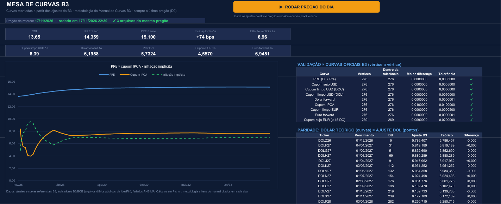
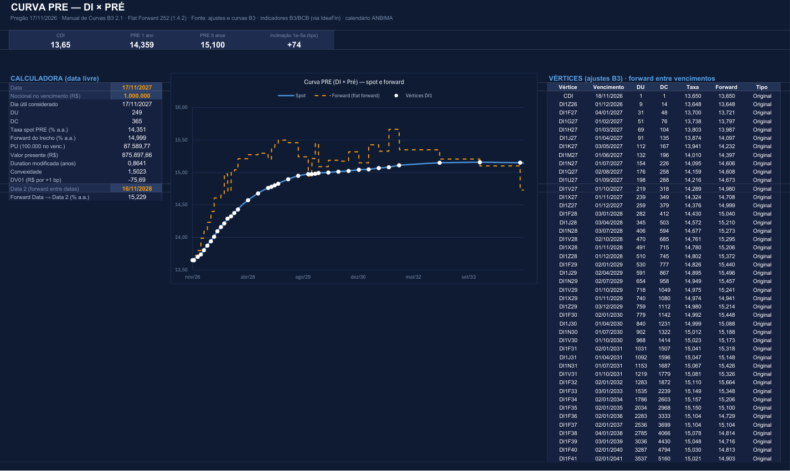
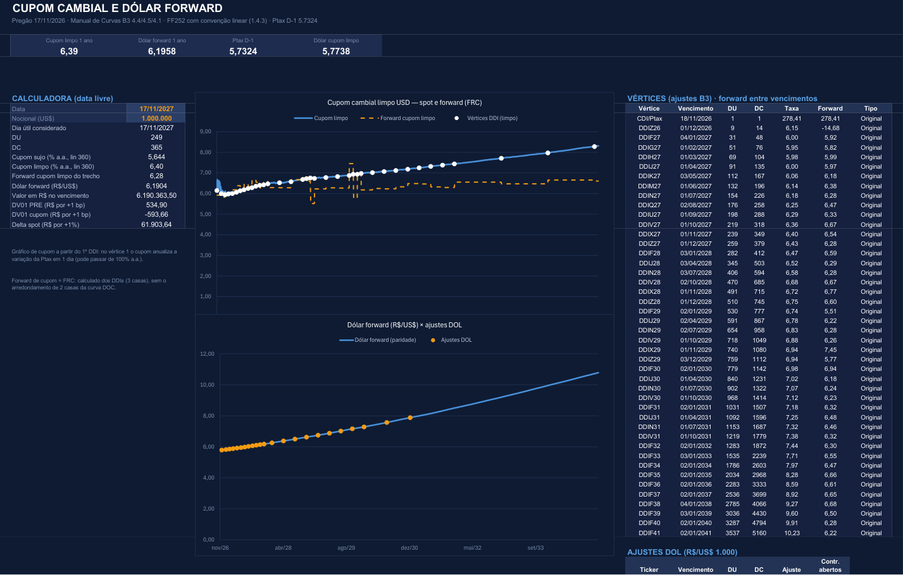
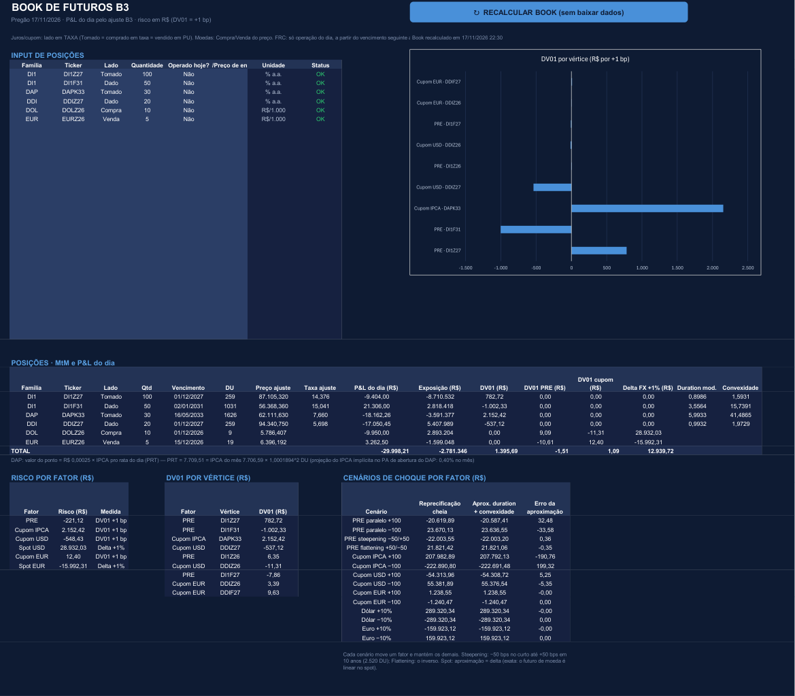

# Book de Curvas — Marcação a Mercado

Simula a rotina de uma mesa de juros e moedas. A partir dos **preços de ajuste da B3 do último pregão**, o
projeto monta as curvas **PRE (DI × Pré)**, **cupom de IPCA**, **cupom cambial** e **cupom de euro**, com
**dólar e euro forward**, e marca a mercado um **book de futuros** (DI1, DAP, DDI/FRC, DOL, EUR) com P&L do
dia, risco e cenários de choque.

Os cálculos são feitos em Python seguindo os manuais da B3 (Manual de Curvas e Manual de Apreçamento de
Futuros) e o resultado sai numa planilha Excel. **A cada execução, as curvas montadas são comparadas vértice
a vértice com as curvas oficiais que a B3 publica no mesmo dia.**



> **Só quer ver o resultado?** Baixe a [planilha de amostra](Amostra_Projeto.xlsx):
> é a saída do projeto para o pregão de 17/11/2026, em `.xlsx` sem macros — os botões não funcionam nela, mas
> as calculadoras de data livre sim. Para os dados do dia, veja [Como usar](#como-usar).

## O que tem na planilha

| Aba | Conteúdo |
|---|---|
| **Painel** | resumo das curvas, PRE × cupom IPCA × inflação implícita, **validação contra as curvas oficiais da B3** e paridade do dólar (teórico × ajuste) |
| **PRE** | curva DI × Pré spot e forward, todo dia útil até 3.000 dias corridos, vértices DI1 e FRA entre vencimentos |
| **IPCA** | cupom de IPCA, inflação implícita e forward |
| **USD** | cupom cambial sujo e limpo, forward de cupom (FRC) e dólar forward × ajustes DOL |
| **EUR** | cupom de euro e euro forward × ajustes EUR |
| **Book** | posições digitadas pelo usuário: MtM, P&L do dia, DV01, duration, convexidade, DV01 por vértice, risco por fator e cenários |

Cada aba de curva tem uma **calculadora de data livre**: para qualquer data (inclusive datas quebradas) dá a
taxa, o forward do trecho, o PU ou o preço forward e as sensibilidades — DV01, duration e convexidade nas
curvas de juros; DV01 da PRE, DV01 do cupom e delta câmbio nas de moeda.



## Metodologia (Manual de Curvas B3 V21)

| Curva | Item | Vértices | Interpolação | Casas |
|---|---|---|---|---|
| PRE | 2.1 | CDI (vértice 1) + taxas de ajuste DI1 | Flat Forward 252 (1.4.2) | 3 |
| Cupom sujo (DOL) | 4.4 | vértice 1 (CDI e variação da Ptax) + DDI | FF252 com convenção linear (1.4.3 / 1.4.10) | 3 |
| Cupom limpo (DOC/DCL) | 4.5 / 4.6 | vértice 1 + DDI convertido pelo dólar cupom limpo | 1.4.3 | 2 |
| Dólar forward (PTX) | 4.1 | paridade com PRE e cupom sujo | — | 7 |
| Cupom IPCA (DPL) | 3.2 | taxas de ajuste DAP; **FF252 sobre a inflação implícita** | 1.4.2 | 2 |
| Cupom de euro (EUC) | 4.7 | cupom limpo ⊗ spread EUR × USD (SDE) | — | 4 |
| Euro forward | 4.2 | paridade com PRE e cupom de euro | — | 7 |

- **Preço e ajuste dos futuros** conforme as especificações dos contratos B3: PU de DI1/DAP em taxa
  exponencial 252, DDI em taxa linear 360, DOL/EUR em R$ por 1.000 unidades; valor do ponto de cada
  contrato (no DAP, R$ 0,00025 × IPCA *pro rata* do dia).
- **P&L do dia** = (ajuste de hoje − PA de abertura) × valor do ponto × quantidade, ou
  (ajuste − preço da operação) para operações do dia. O PA de abertura publicado já vem corrigido pela B3
  (CDI no DI1, CDI ÷ variação da Ptax no DDI, CDI ÷ IPCA *pro rata* no DAP) — conferido com dois pregões
  consecutivos.
- **FRC** é decomposto nas duas pontas de DDI, como na especificação do contrato.
- **Calendário**: feriados nacionais ANBIMA; vencimentos calculados pela regra de cada contrato (EUR:
  fixing 2 dias úteis em Chicago/Nova York antes da 3ª quarta-feira).
- **Sensibilidades** (não estão no manual; derivadas analiticamente das fórmulas de preço): DV01 para +1 bp
  na convenção de cada curva, duration modificada, convexidade, DV01 por vértice (*key rate*) e delta
  câmbio. **Cenários por fator**: PRE paralelo ±100 bps, *steepening* e *flattening*; cupons IPCA, USD e
  EUR ±100 bps; dólar e euro ±10% — reprecificação cheia × aproximação por duration + convexidade.

## Validação

A tabela do Painel compara, em toda execução, cada curva montada com a curva oficial que a B3 publica no dia
(arquivo de Taxas Referenciais). Resultado em quatro pregões:

| Curva | 21/07/2026 | 16/11/2026 | 17/11/2026 | 19/11/2026 | Tolerância |
|---|---|---|---|---|---|
| PRE, cupom sujo, cupom limpo (DOC e DCL) | 272/272 | 278/278 | 276/276 | 277/277 | meia unidade da última casa publicada |
| Dólar forward, cupom de euro, euro forward | 272/272 | 278/278 | 276/276 | 277/277 | idem |
| Cupom IPCA | 272/272 | 278/278 | 276/276 | 277/277 | 0,01 p.p. |
| Cupom sujo de euro (≥ 15 DC, não documentado no manual) | 264/264 | 271/271 | 269/269 | 271/271 | 0,02 p.p. |

Além disso, o **dólar teórico** (Ptax × fator PRE ÷ fator cupom) reproduz o ajuste de todos os vencimentos
de DOL com diferença máxima de 0,001 ponto, e o **forward de cupom** reproduz as taxas de ajuste do FRC
(diferença abaixo de 0,001 p.p., o arredondamento do próprio DDI).

O **P&L do dia** também é conferido com a liquidação oficial: o arquivo de ajustes traz o valor em R$ que a B3
credita ou debita por contrato (`AjusteContrato`). Em DI1, DDI, DOL e EUR o P&L calculado é igual a ele em todos
os contratos dos quatro pregões (diferença de R$ 0,00); no DAP, até R$ 0,01 por contrato quando há o pregão
anterior para medir o IPCA *pro rata*.

O **euro forward** reproduz a curva EUR da B3, mas fica acima dos ajustes dos futuros de euro (até ~0,07%):
a B3 monta essa curva a partir do cupom cambial, do spread EUR × USD e do euro cupom limpo, e não dos futuros
EUR, que são pouco negociados. Os ajustes EUR aparecem na planilha só como referência.

### O que foi preciso para bater com a B3
1. **O manual diz "trunca", a B3 arredonda**: dólar e euro forward só batem arredondando na 7ª casa.
2. **Arredondamento intermediário faz parte da metodologia**: o cupom limpo só bate se a taxa de cada
   vértice DDI for arredondada em 2 casas *antes* de interpolar; o dólar forward, se a PRE e o cupom sujo
   entrarem já arredondados. Em precisão cheia o forward erra até R$ 0,0045/US$.
3. **No cupom de IPCA a interpolação é feita sobre a inflação implícita**, não sobre o cupom.
4. **O DDI longo é derivado do FRC pela própria B3** (Apreçamento, eq. 1.4) — por isso o forward de cupom
   sai dos DDIs e reproduz as FRCs.
5. **O dólar forward sai da curva de cupom**, não dos futuros DOL — não há buraco depois do último DOL, e o
   DOL teórico reproduz os ajustes.
6. **O cupom do vértice 1 pode passar de 900% a.a.**: numa segunda-feira, a variação da Ptax do fim de
   semana é anualizada em 1 dia útil. É a B3, não bug.
7. **Fontes oficiais desatualizadas**: o anexo do ofício de moedas dá o vencimento do EUR no 1º dia útil,
   mas a especificação vigente usa o fixing antes da 3ª quarta-feira (confirmado pelos preços); a curva DCL
   foi renomeada para DCP; o arquivo diário mudou de formato sem aviso — o leitor valida o formato e
   recalcula vencimentos e prazos pelo calendário.
8. **IPCA *pro rata* do DAP conta a partir do dia útil do aniversário**: a especificação diz "dias úteis
   decorridos a partir do dia 15"; quando o dia 15 cai em fim de semana, o ajuste publicado pela B3 só bate
   contando a partir do dia útil seguinte (15/11/2026 foi um domingo).



## Book de futuros

Na aba **Book**, digite as posições (família, ticker, lado, quantidade e, se operado hoje, a taxa ou o
preço) e clique em **Recalcular Book**. Contratos de taxa usam lado em taxa (*Tomado* = comprado em taxa =
vendido em PU); moedas, *Compra/Venda*. Erros de digitação são marcados na própria linha.



## Como usar

**Requisitos:** Windows com Microsoft Excel instalado (a planilha é escrita via xlwings) e Python 3.10+
(testado em Python 3.13 e 3.14, com Excel do Microsoft 365).

```bash
git clone https://github.com/murilomendesz/book-de-curvas-marcacao-a-mercado.git
cd book-de-curvas-marcacao-a-mercado
pip install -r requirements.txt
python main.py
```

Na primeira execução é criada a planilha `Mesa_Curvas_B3.xlsm` (a partir de `modelo/`), com os dados do
último pregão. Ao abrir, clique em **Habilitar Conteúdo** para liberar as macros dos botões:

- **▶ Rodar pregão do dia** (Painel): baixa os arquivos do último pregão e recalcula tudo.
- **↻ Recalcular Book** (Book): recalcula só o book, sem baixar dados.

Observações:
- Se baixar o projeto como ZIP em vez de clonar, antes de extrair clique com o botão direito no ZIP →
  **Propriedades → Desbloquear** (o Windows bloqueia macros de arquivos vindos da internet).
- Os arquivos de um pregão saem à noite, depois do fechamento (o de ajustes por último, por volta das 22h).
  Antes disso o programa exibe o último pregão completo e avisa no Painel.
- Uma execução por vez: se o botão for clicado com outra execução em andamento, o segundo pedido é recusado.
  Cada execução grava um resumo em `data/ultima_execucao.log`.
- `python main.py book` recalcula só o book pelo terminal.

## Estrutura

```
main.py                   ponto de entrada (terminal e botões da planilha)
mesa/
  calendario.py           dias úteis ANBIMA e vencimentos dos contratos
  dados/download.py       download dos arquivos diários do pregão
  dados/leitura.py        leitura e validação do formato dos arquivos
  curvas/interpolacao.py  Flat Forward 252 (1.4.2) e com convenção linear (1.4.3)
  curvas/montagem.py      montagem das curvas (Manual de Curvas B3)
  instrumentos.py         PU, paridade e sensibilidades dos futuros
  book.py                 book: validação do input, P&L do dia, risco e cenários
  saida.py                grades diárias, vértices e indicadores
  validacao.py            curvas montadas × curvas oficiais B3 e paridade do dólar
  excel/                  escrita da planilha, estilo e geração do modelo com as macros
modelo/                   planilha modelo (.xlsm) com as macros dos botões
data/calendario/          feriados nacionais ANBIMA
```

## Limitações e próximos passos

- P&L acumulado desde a entrada não existe (só o P&L do dia): exigiria guardar um histórico próprio.
- FRC só como operação do dia, a partir do vencimento seguinte ao DDI base.
- Três insumos vêm do arquivo de taxas da B3 por não serem reproduzíveis com dados públicos: o spread
  EUR × USD (SDE), o 1º vértice do cupom de IPCA (a B3 usa a projeção de IPCA) e o número-índice do IPCA.
- Cupom de IPCA: diferença de 0,01 p.p. (uma unidade da 2ª casa) em 2 a 4 vértices por pregão. A maioria são
  empates de arredondamento: o vértice coincide com um vencimento DAP cuja taxa termina em 5 na 3ª casa, e a B3
  arredonda alguns desses casos para cima e outros para baixo. Os demais ficam antes do 1º DAP, onde a B3 usa a
  projeção mensal de IPCA (não disponível).
- Cupom sujo de euro: não documentado no manual; exibido só a partir de 15 dias corridos.
- Próximos passos: carry e rolldown, Copom implícito na curva PRE, títulos públicos e viés de convexidade do
  DI1 futuro.

## Fontes

- **Dados**: ajustes do pregão e Taxas Referenciais da B3; Ptax do Banco Central do Brasil; feriados
  nacionais da ANBIMA. Arquivos diários públicos disponibilizados pelo site
  [IdeaFin](https://www.ideafin.com.br/dados).
- **Metodologia**: Manual de Curvas B3 (V21), Manual de Apreçamento de Futuros B3 (V64) e especificações dos
  contratos (ofícios circulares B3 034/2025 e 015/2025, especificação do Futuro de Euro e do FRC).

Projeto educacional, sem relação com a B3. Não é recomendação de investimento.
